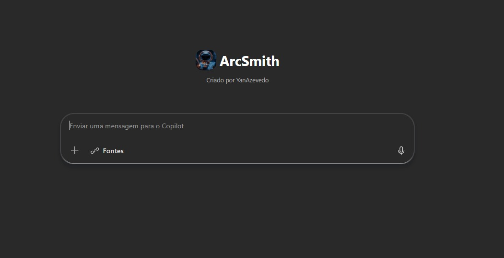

<h1 align="center">⚒️ ArcSmith</h1>

<p align="center">
  
</p>

<p align="center">
  <strong>Forge the arc. Smith the prompt.</strong><br>
  Declarative Agent para Microsoft 365 Copilot — especializado no desenvolvimento estruturado de soluções de IA.
</p>

<p align="center">
  
  
  
  
  
  
</p>

---

## Sobre o projeto

O **ArcSmith** é um agente declarativo construído sobre o Microsoft 365 Copilot que consolida em um único fluxo a metodologia completa de **desenvolvimento de soluções de IA** — desde a captura da necessidade até a entrega da solução final estruturada.

Foi concebido como ferramenta operacional para acelerar e qualificar a construção de prompts e agentes, aplicando engenharia de prompt rigorosa e metodologia autoral fundamentada em prática profissional contínua.

> *"Forje o arco da narrativa. Construa o prompt com precisão."*

---

## Origem do projeto

O ArcSmith nasceu da consolidação de dois agentes autorais anteriores em um único fluxo coeso:

| Agente original | Função | Status no ArcSmith |
|---|---|---|
| **Casetron** | Transformar entrevistas em cases de valor | ✅ Integrado |
| **Prompt Smith** | Engenharia e refinamento de soluções | ✅ Integrado |

A consolidação eliminou a fragmentação entre identificação de oportunidades e construção técnica, permitindo que ambas as etapas operem dentro de um mesmo agente com contexto compartilhado e arquitetura unificada.

### Evolução para a versão 2.0

Na versão 2.0 o ArcSmith evoluiu de bases de conhecimento publicadas no GitHub Pages para **Custom Skills** empacotadas no próprio agente. O conhecimento que antes era consultado por URL agora vive dentro do pacote, organizado em oito skills que carregam sob demanda, e o agente ganhou guias para cada plataforma de agentes do ecossistema Microsoft Copilot.

| Versão | Como o conhecimento chegava ao agente |
|---|---|
| 1.x | ForgeProtocol, SolutionKnowledge e templates publicados no GitHub Pages e lidos via WebSearch |
| 2.0 | Oito Custom Skills no pacote do agente, com o Microsoft Learn MCP como fonte de verdade para fatos de plataforma |

<p align="center">
  
</p>

---

## Arquitetura técnica

O ArcSmith não utiliza RAG técnico tradicional. Na versão 2.0 ele combina um **Core de orquestração** nas instruções, **Custom Skills** carregadas sob demanda, o **Microsoft Learn MCP** para fatos atualizados de plataforma e o grounding nativo no tenant.

```
┌──────────────────────────────────────────────────────────────┐
│                      ARCSMITH 2.0                            │
│           Declarative Agent — Schema v1.9                    │
│                                                              │
│  CORE (instruction.txt)                                      │
│  Identidade · Regra absoluta · Roteamento · Caixas copiáveis │
└──────────────────────────────────────────────────────────────┘
                            │
                CUSTOM SKILLS (sob demanda)
┌──────────────────────────────────────────────────────────────┐
│  arc-cases            Seleção, classificação e cases         │
│  smith-prompt         Modos de criação, Prompt-Base e skills │
│  copilot-chat         Agentes para Copilot Basic             │
│  copilot-m365-agent-builder   Agent Builder (2 modos)        │
│  copilot-m365-toolkit         Agentes declarativos em código │
│  copilot-studio       Harness, ferramentas, fluxos, créditos │
│  copilot-notebooks    Notebooks completos                    │
│  documentacao         Discovery e Guia de Criação (.docx)    │
└──────────────────────────────────────────────────────────────┘
                            │
        ┌───────────────────┼───────────────────┐
        ▼                   ▼                   ▼
┌───────────────┐  ┌────────────────┐  ┌─────────────────┐
│ Microsoft     │  │ CODE           │  │ TENANT M365     │
│ Learn MCP     │  │ INTERPRETER    │  │ OneDrive,       │
│ Fonte de      │  │ Análise e      │  │ SharePoint,     │
│ verdade       │  │ geração .docx  │  │ Teams, Email    │
└───────────────┘  └────────────────┘  └─────────────────┘
```

---

## Capacidades

### 🎯 Módulo Arc — Seleção e Documentação de Cases

Interpreta transcrições, anotações e resumos da reunião de discovery e conduz o cliente até a decisão do case a construir.

- Identificação automática de múltiplos cases em uma única transcrição
- Um case: documentação e documento do case direto; vários cases: relatório de seleção para aprovação do cliente e, depois, a documentação do case escolhido
- Classificação **Aderente** (complexidade de construção e de sustentação: Baixa, Média ou Alta) ou **Viável em projeto**
- Dor, O que resolve, Impacto e Valor em todo case
- Reconstrução do processo atual (AS-IS) e apoio da matriz Impacto vs. Esforço na recomendação

### ⚒️ Módulo Smith — Criação de Agentes

Constrói o agente completo, começando pela escolha do modo de criação, com recomendação do ArcSmith.

- **Modo Assistente:** entrevista ponto a ponto e briefing único para a conversa de criação do Agent Builder (Copilot Basic e Premium)
- **Modo Detalhado:** camada por camada no Agent Builder manual, Agents Toolkit, Copilot Studio e Copilot Notebooks
- **Verificação de recursos** no primeiro passo: o que o nível e a plataforma permitem hoje, confirmado no Microsoft Learn, com fonte e data
- Skills do agente criado, quando a verificação confirmar suporte: descrição no briefing (Assistente) ou `SKILL.md` e pacote `.zip` (Detalhado)

- Prompt-Base em JSON com sete parâmetros, nesta ordem: Goal, Context, Instructions, Tone, Format, Use Case e Output
- Nome, título, descrição, instruções e prompts iniciais sempre em caixas copiáveis
- Limite de 8.000 caracteres do agente criado, contando o bloco inteiro
- Edição incremental sem perda de coerência e comando de reset

### 🧭 Guias por plataforma

Uma skill para cada tipo de solução, com campos, limites, licenças e passo a passo confirmados no Microsoft Learn:

- **Copilot Basic e Premium** — dois níveis: Copilot Chat sem licença (Basic) e Microsoft 365 Copilot ou cobrança por consumo (Premium)
- **Agent Builder** — criação manual ou assistida em linguagem natural
- **Agents Toolkit** — manifestos, capabilities, skills, MCP e ciclo de provision
- **Copilot Studio** — harnesses, conhecimento, ferramentas, tópicos, fluxos e Copilot Credits
- **Copilot Notebooks** — instruções, referências recomendadas e estrutura de uso

### 📄 Documentação de entrega

- **Seleção de Cases** (vários cases, para decisão do cliente) e **Documento do Case** (case único ou escolhido), pelo `gerar discovery`
- **Guia de Criação do Agente** (`gerar entrega`) adaptado à plataforma, com seção de sustentação
- O agente sempre pergunta antes de gerar; todo documento segue o padrão do **Brandbook Cloud Target – Modern Work & IA** (capa escura com logo neon, paleta Deep/Purple/Neon, Poppins), com nome do cliente, título, subtítulo e pontos-chave, gerado pelo script `brand_docx.py` da skill documentacao
- **Formalização pós-discovery:** e-mail completo criado como rascunho no Outlook (`EmailActions`), nunca enviado pelo agente, e mensagem do Teams em caixa copiável
- Formatação padronizada e blocos de cópia para todo conteúdo a copiar e colar

### 🧪 Módulo Code Interpreter — Análise e Visualização

Executa Python em sandbox para apoiar análise de dados, validação de JSONs e geração de artefatos para entrega.

- Validação e formatação de Prompt-Base JSON
- Análise de planilhas de levantamento (CSV/TSV)
- Geração de gráficos de complexidade e priorização
- Criação de arquivos para entrega ao usuário final

### 🌐 Microsoft Learn MCP (Model Context Protocol)

Conexão dinâmica com a documentação oficial Microsoft em tempo real, garantindo que o agente nunca prometa funcionalidades inexistentes do Copilot.

- `microsoft_docs_search` — busca semântica na documentação oficial
- `microsoft_docs_fetch` — recuperação de páginas completas em markdown
- `microsoft_code_sample_search` — exemplos de código oficiais

Na versão 2.0, o Learn é a **fonte de verdade** para fatos de plataforma: em conflito com o conteúdo das skills, o Learn prevalece.

### 🏢 Grounding nativo no Tenant M365

Acesso direto ao contexto do usuário via capabilities nativas do Declarative Agent.

- **OneDriveAndSharePoint** — documentos, OneNote, arquivos
- **TeamsMessages** — conversas, canais, chats
- **Email** — histórico de e-mails do usuário
- **EmailActions** — criação do rascunho do e-mail de formalização, sempre revisado e enviado pelo usuário

---

## Metodologia autoral

O ArcSmith opera sobre uma metodologia própria de construção de soluções de IA para Microsoft Copilot, fundamentada em prática profissional contínua em múltiplos contextos e alinhada a princípios reconhecidos internacionalmente.

### Princípios fundamentais

- **Valor de negócio em primeiro lugar** — soluções devem gerar benefício tangível
- **IA como extensão cognitiva, não substituição** — ampliar capacidades humanas
- **Consultoria antes de tecnologia** — entender o problema antes de propor ferramenta
- **Iteração orientada a feedback** — desenvolvimento incremental com usuários
- **Simplicidade e clareza** — menos é mais
- **Ética e privacidade por padrão** — uso responsável de dados
- **Foco no usuário final** — adoção real define sucesso
- **Mensurabilidade do valor** — métricas comprovam impacto

### Bases de conhecimento

| Versão | Base | Onde vive |
|---|---|---|
| 1.x | **ForgeProtocol** e **SolutionKnowledge** | GitHub Pages, lidos via WebSearch |
| 2.0 | Metodologia e engenharia de prompt migradas para as skills `arc-cases` e `smith-prompt` | Pacote do agente (Custom Skills) |

Os arquivos da 1.x continuam em `docs/` como histórico. O agente usa a versão empacotada nas skills.

---

## Stack técnica

| Camada | Tecnologia |
|---|---|
| **Plataforma** | Microsoft 365 Copilot |
| **Framework** | Microsoft 365 Agents Toolkit |
| **Schema** | Declarative Agent v1.9 |
| **Modo de resposta** | Think deeper (raciocínio profundo) |
| **Conhecimento** | 8 Custom Skills (preview) no pacote |
| **Fonte de verdade** | Microsoft Learn MCP (HTTP) |
| **Grounding tenant** | OneDrive, SharePoint, Teams, Email |
| **Análise de dados** | Code Interpreter (Python sandbox) |
| **Versionamento** | Git + GitHub |
| **Idioma operacional** | pt-BR |

---

## Comportamento avançado

O ArcSmith opera com configurações de comportamento do schema que elevam significativamente a qualidade das respostas:

```json
"behavior_overrides": {
  "default_response_mode": "Think deeper",
  "special_instructions": {
    "discourage_model_knowledge": true
  }
}
```

- **Think deeper** — modo de raciocínio profundo ativado por padrão, alinhado com Chain of Thought e Extreme Ownership
- **Discourage model knowledge** — prioriza o conhecimento das skills e do Microsoft Learn MCP sobre o conhecimento genérico do modelo

---

## Estrutura do repositório

```
Arc.Smith/                      # Raiz do repositório
├── Arc.Smith/                  # Projeto do Agents Toolkit (provisionado)
│   ├── appPackage/
│   │   ├── ai-plugin.json          # Plugin MCP (Microsoft Learn)
│   │   ├── mcp-tools.json          # Ferramentas do MCP
│   │   ├── declarativeAgent.json   # Definição principal do agente
│   │   ├── instruction.txt         # Core (≤8000 caracteres)
│   │   ├── manifest.json           # Manifesto do app M365
│   │   ├── skills/                 # 8 Custom Skills (SKILL.md + references/)
│   │   ├── color.png               # Ícone principal (192x192)
│   │   └── outline.png             # Ícone de contorno (32x32)
│   ├── docs/                   # Mapa de migração e método de atualização
│   ├── env/
│   ├── m365agents.yml
│   └── README.md               # Documentação técnica
├── Arc.Smith-EN/               # Espelho em inglês do Core e das skills
├── docs/                       # Fontes da 1.x (histórico) e imagens
├── CHANGELOG.md
├── README.md                   # Este documento
└── LICENSE.md
```

---

## Pré-requisitos

- **Node.js** 18, 20 ou 22
- **Microsoft 365 Agents Toolkit** (VS Code extension 5.0.0+)
- **Licença Microsoft 365 Copilot**
- **Conta Microsoft 365** para desenvolvimento
- **Microsoft Frontier Program** habilitado no tenant (Custom Skills em preview)
- Variável de ambiente `TEAMSFX_AGENT_SKILLS=true` antes de abrir o VS Code

---

## Como executar

```bash
# 1. Clone o repositório
git clone https://github.com/Yan-Azevedo/Arc.Smith.git

# 2. Abra no VS Code
code Arc.Smith

# 3. Habilite as skills (uma vez por máquina) e reinicie o VS Code
#    [System.Environment]::SetEnvironmentVariable("TEAMSFX_AGENT_SKILLS","true","User")

# 4. Faça login no painel do M365 Agents Toolkit

# 5. Incremente a versão no manifest.json (se houver mudanças)

# 6. Execute o Provision pelo painel Lifecycle do Toolkit
```

Após o Provision, o ArcSmith estará disponível em [m365.cloud.microsoft](https://m365.cloud.microsoft) na lista de agentes.

---

## Status do projeto

| Componente | Status |
|---|---|
| Core de orquestração (instruction.txt) | ✅ Reescrito na 2.0 |
| Módulo Arc (skill arc-cases) | ✅ Operacional |
| Módulo Smith (skill smith-prompt) | ✅ Operacional, com modos Assistente e Detalhado |
| Guias por plataforma (5 skills) | ✅ Habilitados |
| Documentação de entrega (skill documentacao) | ✅ Habilitada |
| Microsoft Learn MCP | ✅ Integrado (3 ferramentas) |
| Code Interpreter | ✅ Ativo |
| Grounding M365 (Teams, OneDrive, Email) | ✅ Habilitado |
| Espelho em inglês (Arc.Smith-EN) | ✅ Disponível |
| Rascunho de e-mail de formalização (EmailActions) | 🧪 A validar no tenant |
| Envio de mensagem no Teams | ⏸️ Evolução futura (hoje em caixa copiável) |
| Embedded Knowledge | ⏸️ Aguardando suporte à combinação com skills |

---

## Licença

Projeto **proprietário**, de uso exclusivo do autor, mantido em repositório privado. Todos os direitos reservados. Até a versão 1.x o projeto foi distribuído sob CC BY-NC-ND 4.0.

Consulte [LICENSE.md](LICENSE.md) para os termos completos.

---

## Autor

**Yan Azevedo**

Projeto autoral fundamentado em metodologia própria construída a partir de prática profissional contínua. O ArcSmith é uma ferramenta operacional para acelerar e qualificar o desenvolvimento de soluções de IA com Microsoft Copilot.

---

<p align="center">
  <em>"Forje o arco da narrativa. Construa o prompt com precisão."</em>
</p>